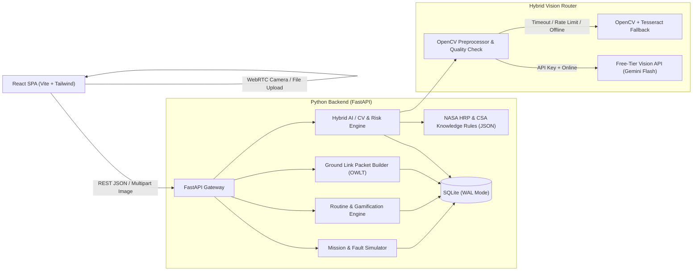
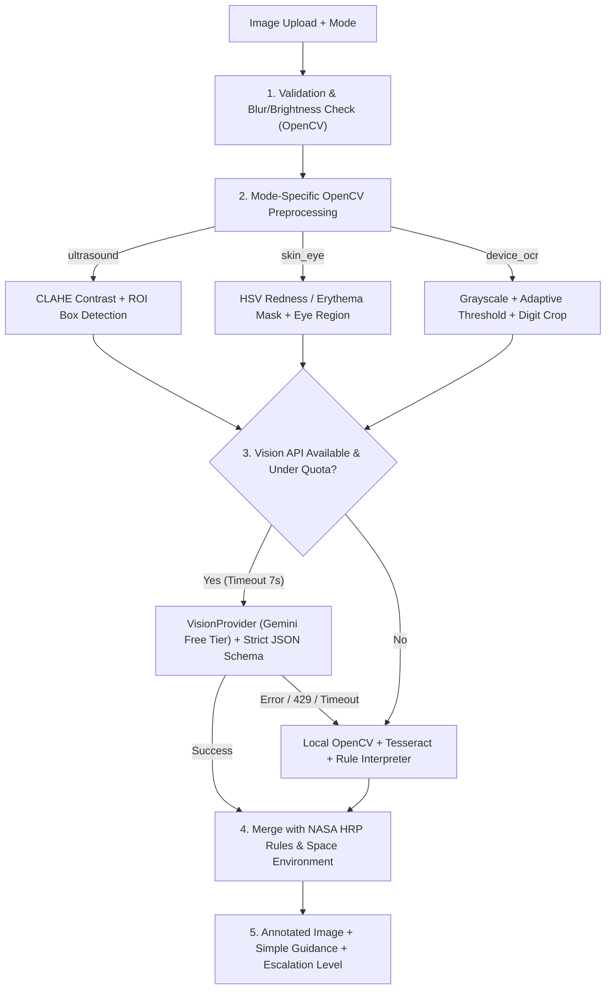
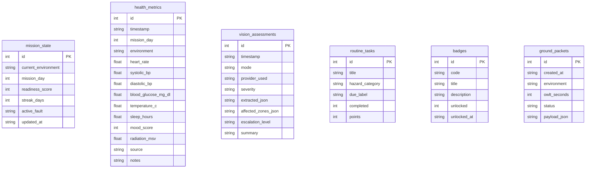

# ARCHITECTURE.md — ASTRA-Med

**Проєкт:** ASTRA-Med (*Autonomous Space Telemetry & Risk Assessment*)  
**Призначення документа:** єдина технічна архітектура, API-контракти, схема даних та гібридний AI/CV-пайплайн для паралельної роботи всіх 4 учасників команди.

---

## 1. Загальна архітектура системи

Система побудована як монолітний модульний бекенд на **Python (FastAPI)** з локальною базою **SQLite** (символізує повну автономність бортового ПЗ без обов’язкового інтернету) та окремий SPA-фронтенд на **React + TypeScript**.



---

## 2. Технологічний стек

| Шар | Технології | Роль |
| :--- | :--- | :--- |
| **Frontend** | React 18+, TypeScript, Vite, Tailwind CSS | Інтерфейс бортової консолі (EN) |
| **Body Map & Charts** | Кастомний інтерактивний SVG + Recharts (або Apache ECharts) | Клікабельні шари тіла та динамічні тренди |
| **Media Capture** | Browser WebRTC (`getUserMedia`) + Drag & Drop | Захоплення фото з камери або завантаження УЗД |
| **Backend API** | Python 3.11+, FastAPI, Uvicorn, Pydantic v2 | REST API, валідація контрактів, Swagger `/docs` |
| **Database** | SQLite (`sqlite3` / `aiosqlite` у режимі WAL) | Локальне збереження метрик, історії, пакетів зв’язку |
| **AI / Vision API** | `google-genai` (Gemini Free Tier як основний) через абстрактний інтерфейс `VisionProvider` | Мультимодальний аналіз УЗД, шкіри/очей, приладів та пояснення |
| **Local CV Fallback** | `opencv-python-headless`, `numpy`, `Pillow`, `pytesseract` | Контраст/ROI для УЗД, HSV-аналіз почервоніння, OCR без мережі |
| **Tooling & QA** | `uv` (або `venv + pip`), `ruff`, `pytest` | Залежності, лінтинг і автотести |

---

## 3. Структура папок репозиторію

- **Корінь бекенду (FastAPI + SQLite):** `backend/` (`backend/app/main.py`, `backend/app/database.py`, `backend/app/schemas.py`, `backend/app/routers/`, `backend/app/services/`, `backend/tests/`)
- **Модуль AI / CV та діагностики:** `backend/app/services/risk_engine.py`, `backend/app/services/vision_service.py`, `backend/app/routers/vision.py`
- **Корінь фронтенду (React + Vite):** `frontend/` (резерв для Ролі 1)
- **Датасети NASA/CSA (JSON-правила, 30-денний seed, тестові УЗД/фото):** `data/nasa_hrp_rules.json`, `data/seed_30days.json`, `data/demo_samples/`
- **Скрипти запуску / Docker (`run_dev.sh`, `docker-compose.yml`):** `scripts/run_dev.sh`, `scripts/generate_demo_images.py`, `docker-compose.yml`, `backend/Dockerfile`

```text
NASA-Space-Apps-Challenge_Health_Monitoring_System/
├── README.md
├── SPECS.md
├── ARCHITECTURE.md
├── .gitignore
├── .env.example
├── docker-compose.yml
├── scripts/
│   ├── run_dev.sh
│   └── generate_demo_images.py
├── data/
│   ├── nasa_hrp_rules.json
│   ├── seed_30days.json
│   └── demo_samples/
│       ├── README.md
│       ├── sample_ultrasound.png
│       ├── sample_skin_eye.png
│       └── sample_device_ocr.png
├── backend/
│   ├── Dockerfile
│   ├── requirements.txt
│   ├── pyproject.toml
│   ├── app/
│   │   ├── __init__.py
│   │   ├── main.py
│   │   ├── config.py
│   │   ├── database.py
│   │   ├── schemas.py
│   │   ├── routers/
│   │   │   ├── __init__.py
│   │   │   ├── dashboard.py
│   │   │   ├── metrics.py
│   │   │   ├── mission.py
│   │   │   ├── routine.py
│   │   │   ├── ground.py
│   │   │   └── vision.py
│   │   └── services/
│   │       ├── __init__.py
│   │       ├── seed_service.py
│   │       ├── risk_engine.py
│   │       ├── mission_simulator.py
│   │       ├── routine_service.py
│   │       ├── ground_service.py
│   │       └── vision_service.py
│   └── tests/
│       ├── __init__.py
│       └── test_api.py
└── frontend/
    └── README.md
```

---

## 4. Спільний API-контракт (Основа для паралельної розробки)

Усі 4 учасники орієнтуються на фіксовані схеми нижче. Фронтенд може підніматися на моках із цих JSON-структур із першої години.

### 4.1. `GET /api/health`
Перевірка працездатності бекенду, стану БД та доступності Vision API.
```json
{
  "status": "ok",
  "vision_provider": "gemini_free_ready",
  "tesseract_available": true,
  "mission_day": 24
}
```

### 4.2. `GET /api/dashboard`
Повертає повний поточний стан для головного екрана (середовище, OWLT, індекс здоров’я, статуси зон тіла, останні метрики, рутину, бейджі).
```json
{
  "mission": {
    "environment": "spacecraft",
    "mission_day": 24,
    "owlt_seconds": 860,
    "owlt_label": "14m 20s (Mars Transit)",
    "active_fault": null
  },
  "gamification": {
    "readiness_score": 84,
    "streak_days": 6,
    "badges": [
      { "code": "bone_guardian", "title": "Bone Guardian", "unlocked": true },
      { "code": "circadian_master", "title": "Circadian Master", "unlocked": false }
    ]
  },
  "body_zones": [
    {
      "zone_id": "heart_vessels",
      "layer": "cardiovascular",
      "label": "Heart & Vessels",
      "status": "nominal",
      "summary": "Resting HR and BP within microgravity baseline.",
      "space_hazard": "Gravity Fields (cephalad fluid shift)",
      "self_exam_guide": "Sit still for 3 minutes, wrap cuff at heart level, press Measure."
    }
  ],
  "latest_metrics": {
    "heart_rate": 68,
    "systolic_bp": 118,
    "diastolic_bp": 76,
    "blood_glucose_mg_dl": 94,
    "temperature_c": 36.7,
    "sleep_hours": 6.8,
    "mood_score": 8,
    "radiation_msv_total": 14.2
  },
  "routine_tasks": [
    {
      "id": 1,
      "title": "Log Morning Glucose (mg/dL)",
      "hazard_category": "Nutrition & Metabolism",
      "due_label": "Due in 45 min",
      "completed": false,
      "points": 15
    }
  ]
}
```

### 4.3. `GET /api/metrics/history?days=30`
Історія замірів + динамічні космічні межі норми для побудови графіків у Recharts/ECharts.
- Відповідь: масив записів (`timestamp`, `mission_day`, усі 7 біометричних полів, `source`) + об’єкт `thresholds` (для кожного показника: `nominal_min`, `nominal_max`, `caution_min`, `caution_max` з урахуванням поточного середовища) + `trend_alerts[]`.

### 4.4. `POST /api/metrics`
Додає новий замір (ручний ввід або підтверджений після OCR) і повертає оновлену оцінку ризику.
- **Request JSON:**
  ```json
  {
    "heart_rate": 88,
    "systolic_bp": 134,
    "diastolic_bp": 86,
    "blood_glucose_mg_dl": 142,
    "temperature_c": 37.2,
    "sleep_hours": 5.0,
    "mood_score": 5,
    "radiation_msv_daily": 1.4,
    "notes": "Mild headache after EVA",
    "source": "manual"
  }
  ```
- **Response JSON:** оновлений об’єкт запису + `evaluation` (змінені статуси `body_zones`, виявлені тренди, рекомендації, `escalation_level`).

### 4.5. `POST /api/vision/analyze`
Аналіз зображення (`multipart/form-data`):
- **Поля запиту:**
  - `image`: файл зображення (`png` / `jpg` / `webp`);
  - `mode`: `"ultrasound"` | `"skin_eye"` | `"device_ocr"`;
  - `environment`: `"spacecraft"` | `"station"` | `"rover"` | `"base"`;
  - `context_notes` (optional string).
- **Response JSON:**
  ```json
  {
    "mode": "ultrasound",
    "provider_used": "gemini_free",
    "severity": "caution",
    "confidence": 0.82,
    "extracted_value": null,
    "affected_body_zones": ["lungs_airway"],
    "roi_boxes": [
      { "x": 0.25, "y": 0.30, "w": 0.40, "h": 0.35, "label": "B-line cluster region" }
    ],
    "annotated_image_base64": "data:image/jpeg;base64,...",
    "space_hazard_link": "Hostile Closed Environments / Microgravity fluid shift",
    "explanation_simple": "Detected localized vertical ultrasound artifacts suggesting mild fluid retention.",
    "action_steps": [
      "Repeat scan on both lung fields in 4 hours to verify persistence.",
      "Review cabin CO2 and hydration intake logs.",
      "Ask crew medical officer to inspect breathing rate."
    ],
    "escalation_level": "crew_attention"
  }
  ```
  *Примітка для `device_ocr`:* у `extracted_value` повертається `{ "metric": "blood_glucose_mg_dl", "value": 138, "unit": "mg/dL" }`, щоб фронтенд показав кнопку `Confirm & Log`.

### 4.6. `POST /api/evaluate/risk`
Комбінована оцінка ризиків (враховує останні показники, 14-денні тренди, останній CV-результат та поточне середовище).

### 4.7. `POST /api/mission/environment` & `POST /api/demo/fault`
- `POST /api/mission/environment`: `{ "environment": "rover" }` — змінює профіль середовища, OWLT і перераховує пороги.
- `POST /api/demo/fault`: `{ "fault": "solar_flare" | "co2_drift" | "sleep_deficit" | "reset_baseline" }` — ін’єктує реалістичну кризу для живого демо.

### 4.8. `POST /api/routine/{task_id}/complete`
Позначає задачу рутини виконаною, нараховує бали до `readiness_score`, перевіряє розблокування бейджів.

### 4.9. `POST /api/ground/transmit`
Формує компактний `Telemetry & Medical Packet` для наземного Flight Surgeon, фіксує `owlt_seconds` і повертає згенерований JSON + текстове зведення зі статусом передачі.

---

## 5. Гібридний пайплайн AI / Computer Vision & Risk Engine

Цей модуль гарантує **нульовий шанс падіння під час демо** навіть без інтернету або при вичерпанні безкоштовної квоти Vision API.



### Як працюють три CV-режими в обох гілках
1. **`ultrasound`:**
   - *OpenCV pre-processing / fallback:* підсилення контрасту (`CLAHE`), пошук гіперехогенних/вертикальних зон (`Sobel`/морфологія) або аномальної площі темної порожнини, малювання ROI-рамки.
   - *Vision API:* передача підготовленого УЗД-кадру з промптом NASA-самообстеження; повернення простих висновків та рекомендацій.
2. **`skin_eye`:**
   - *OpenCV pre-processing / fallback:* конвертація в `HSV`, обчислення індексу почервоніння (`erythema ratio`) у центральній зоні / зоні ураження, виділення контурів запалення.
   - *Vision API:* класифікація візуальних ознак (висип від сухості/замкненого середовища, подразнення очей / SANS-тригери) з жорсткою забороною категоричних клінічних діагнозів.
3. **`device_ocr`:**
   - *OpenCV pre-processing / fallback:* пошук контрастного прямокутника дисплея, бінаризація, розпізнавання цифр через `pytesseract` (`--psm 7 -c tessedit_char_whitelist=0123456789.`) + санітарна валідація діапазонів (`glucose: 40-400`, `temp: 34.0-42.0`, `bp: 60-220`).
   - *Vision API:* пряме зчитування показників і одиниць виміру з фото екрану, якщо екран під кутом або з відблисками.

### Логіка оцінки ризиків і трендів (`Rule + Trend Engine`)
1. **Статична оцінка:** порівняння кожного індикатора з космічними межами (наприклад, для мікрогравітації допускається помірне зсунення базових показників, на відміну від земних норм).
2. **Трендова оцінка (5–14 днів):** лінійний нахил (slope) сну, ЧСС спокою, глюкози та настрою. Якщо сон знижується ≥ 3 дні поспіль і росте ЧСС — підіймається тригер `Behavioral / Circadian Drift`.
3. **Матриця ескалації:**
   - Жоден показник не в червоній зоні, ≤ 1 в жовтій → `self_care`.
   - ≥ 2 показники в жовтій зоні або помірна CV-аномалія → `crew_attention`.
   - Будь-який показник у червоній зоні, критична радіація (`Solar Particle Event`) або тривожний УЗД-результат → `flight_surgeon`.

---

## 6. Схема бази даних (SQLite)



---

## 7. Запуск, конфігурація та деплой

### 7.1. Змінні середовища (`.env`)
У репозиторії зберігається лише `.env.example` (без реальних ключів):
```env
GEMINI_API_KEY=your_free_tier_key_here
GEMINI_MODEL=gemini-2.5-flash
VISION_TIMEOUT_SECONDS=7
SQLITE_DB_PATH=./astra_med.db
CORS_ORIGINS=http://localhost:5173
```
*Якщо `GEMINI_API_KEY` не задано або порожній — система автоматично запускається в режимі `offline_opencv_only` без падінь.*

### 7.2. Локальний запуск (для розробки та живого демо)
- **Скрипт `./scripts/run_dev.sh`:** стартує FastAPI (`uvicorn` на порту `8000`) та Vite dev server (`5173`) однією командою.
- **`docker-compose.yml`:** два контейнери (`backend` з встановленим `tesseract-ocr` та змонтованим SQLite volume + `frontend`), що гарантує ідентичне середовище у всіх 4 учасників.

### 7.3. Хмарний деплой (опціонально для суддів)
- **Backend (`Dockerfile`):** Python 3.11-slim + системний пакет `tesseract-ocr` + `libglib2.0-0` (для OpenCV) → деплой на Render / Railway / Fly.io.
- **Frontend:** статичний білд `npm run build` → деплой на Vercel / Netlify зі змінною `VITE_API_BASE_URL`.
