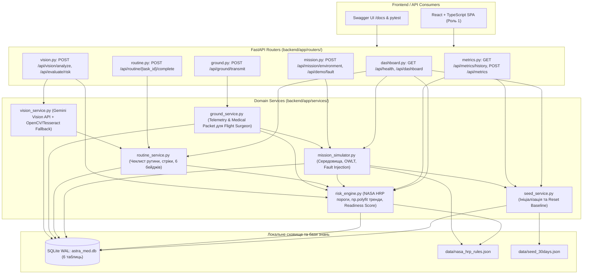
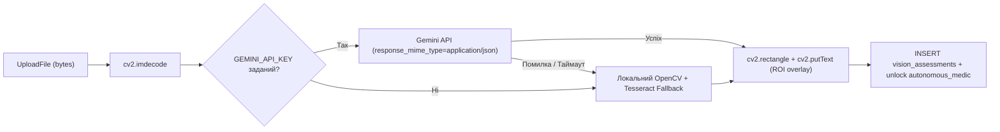

# ARCHITECTURE_2.0.md — ASTRA-Med (Розширена технічна специфікація)

**Проєкт:** ASTRA-Med (*Autonomous Space Telemetry & Risk Assessment*)  
**Команда:** `xterra` — NASA Space Apps Challenge 2026  
**Статус документа:** Розширена архітектура v2.0 (відображає фактично реалізований модульний бекенд, усі повні JSON-контракти, внутрішні алгоритми оцінки ризиків, симулятора місії та гібридного CV-пайплайну; базовий файл `ARCHITECTURE.md` збережено без змін).

---

## 1. Розширена архітектура системи та сервісних шарів

Бекенд побудований за модульною тришаровою архітектурою (`Routers → Services → SQLite WAL + JSON Knowledge Base`), де кожен сервіс ізольований і відповідає за окремий домен місії.



---

## 2. Повна структура файлів та зона відповідальності командних ролей

| Шлях | Роль команди | Відповідальність у системі |
| :--- | :--- | :--- |
| `backend/app/main.py` | Роль 2 | Ініціалізація FastAPI, `lifespan` (створення БД та seed на старті), CORS, підключення роутерів, `GET /`. |
| `backend/app/config.py` | Роль 2 | Завантаження `.env` без сторонніх залежностей, `Settings`, кешоване читання `data/nasa_hrp_rules.json` і `data/seed_30days.json`. |
| `backend/app/database.py` | Роль 2 | SQLite-підключення з `PRAGMA journal_mode=WAL` та `PRAGMA foreign_keys=ON`, контекстний менеджер `db_session()`, DDL для 6 таблиць. |
| `backend/app/schemas.py` | Роль 2 / Роль 1 | Суворі Pydantic v2 контракти запитів/відповідей для всіх ендпоїнтів та валідація фізіологічних діапазонів. |
| `backend/app/services/seed_service.py` | Роль 2 | Ідемпотентний `ensure_seeded()` та повне відновлення 24-денного стану `reset_to_baseline()`. |
| `backend/app/services/mission_simulator.py` | Роль 2 | Контекст місії, OWLT, перемикач 4 середовищ, ін'єкція криз `solar_flare`, `co2_drift`, `sleep_deficit`, `reset_baseline`. |
| `backend/app/services/routine_service.py` | Роль 2 | Виконання завдань рутини, інкремент `streak_days`, розблокування 6 бейджів. |
| `backend/app/services/ground_service.py` | Роль 2 | Збірка структурованого `Telemetry & Medical Packet` (JSON + текстовий бриф) для Flight Surgeon із фіксацією OWLT. |
| `backend/app/services/risk_engine.py` | Роль 2 + Роль 3 | Класифікація метрик за порогами NASA HRP, 5–14-денні лінійні тренди (`np.polyfit`), мапінг на 8 зон тіла, 3 рівні ескалації, динамічний `readiness_score`. |
| `backend/app/services/vision_service.py` | Роль 2 + Роль 3 | Гібридний CV-рутер: Gemini Free Tier (`google-genai`) + детермінований OpenCV/Tesseract fallback для `ultrasound`, `skin_eye`, `device_ocr`. |
| `backend/tests/test_api.py` | Роль 2 / QA | Автотести `pytest` (`TestClient` з ізольованою тимчасовою SQLite БД) на всі маршрути та сценарії криз. |
| `data/nasa_hrp_rules.json` | Роль 4 | Довідник 4 середовищ, матриця порогів та повні медичні описи/інструкції самообстеження для 8 зон тіла. |
| `data/seed_30days.json` | Роль 4 | 24-денний базовий таймлайн, дефолтні завдання рутини та бейджі. |
| `data/demo_samples/` | Роль 4 / Роль 3 | Тестові зображення для 3 CV-режимів (`scripts/generate_demo_images.py`). |
| `frontend/` | Роль 1 | Робоча директорія для React + TypeScript + Vite + Tailwind SPA. |

---

## 3. Повний REST API довідник (Запити та Відповіді)

Усі маршрути префіксовані `/api`, крім кореневого `GET /`. Інтерактивна специфікація OpenAPI доступна на `GET /docs`.

### 3.0. `GET /` — Discovery
```json
{
  "service": "ASTRA-Med Backend",
  "team": "xterra",
  "docs": "/docs",
  "health": "/api/health"
}
```

### 3.1. `GET /api/health`
Перевіряє працездатність БД, наявність `GEMINI_API_KEY` (`gemini_free_ready` або `offline_opencv_ready`), наявність системного бінарника `tesseract` та поточний день місії.
```json
{
  "status": "ok",
  "vision_provider": "offline_opencv_ready",
  "tesseract_available": false,
  "mission_day": 24
}
```

### 3.2. `GET /api/dashboard`
Агрегує поточний стан місії, гейміфікацію, усі 8 зон тіла (перераховані через `evaluate_risk`), останні показники та список рутини.
```json
{
  "mission": {
    "environment": "spacecraft",
    "mission_day": 24,
    "owlt_seconds": 860,
    "owlt_label": "14m 20s (Mars Transit)",
    "active_fault": null
  },
  "gamification": {
    "readiness_score": 84,
    "streak_days": 6,
    "badges": [
      {
        "code": "bone_guardian",
        "title": "Bone Guardian",
        "description": "Completed ARED resistive bone-density countermeasures consistently.",
        "unlocked": true,
        "unlocked_at": "2026-11-13T20:56:59+00:00"
      }
    ]
  },
  "body_zones": [
    {
      "zone_id": "heart_vessels",
      "layer": "cardiovascular",
      "label": "Heart & Vessels",
      "status": "nominal",
      "summary": "Resting HR and BP within microgravity baseline.",
      "space_hazard": "Gravity Fields (cephalad fluid shift) & Hostile Closed Environments (CO2 load)",
      "self_exam_guide": "Sit still for 3 minutes, wrap cuff at heart level, press Measure, and log systolic/diastolic values.",
      "organ_function": "Maintains systemic perfusion and blood pressure regulation under altered gravity.",
      "why_exam_needed": "Microgravity shifts fluid toward the thorax and head, shrinking plasma volume and risking orthostatic intolerance."
    }
  ],
  "latest_metrics": {
    "heart_rate": 68.0,
    "systolic_bp": 118.0,
    "diastolic_bp": 76.0,
    "blood_glucose_mg_dl": 94.0,
    "temperature_c": 36.7,
    "sleep_hours": 6.8,
    "mood_score": 8,
    "radiation_msv_total": 14.2,
    "radiation_msv_daily": 0.59
  },
  "routine_tasks": [
    {
      "id": 1,
      "title": "Log Morning Glucose (mg/dL)",
      "hazard_category": "Nutrition & Metabolism",
      "due_label": "Due in 45 min",
      "completed": false,
      "points": 15
    }
  ]
}
```

### 3.3. `GET /api/metrics/history?days=30`
Повертає записи в хронологічному порядку (`ORDER BY mission_day ASC, id ASC`), межі норми для поточного середовища та знайдені трендові попередження. Параметр `days` валідується в діапазоні `1..90` (дефолт `30`).
```json
{
  "environment": "spacecraft",
  "days_requested": 30,
  "records": [
    {
      "id": 24,
      "timestamp": "2026-11-13T20:56:59+00:00",
      "mission_day": 24,
      "environment": "spacecraft",
      "heart_rate": 68.0,
      "systolic_bp": 118.0,
      "diastolic_bp": 76.0,
      "blood_glucose_mg_dl": 94.0,
      "temperature_c": 36.7,
      "sleep_hours": 6.8,
      "mood_score": 8,
      "radiation_msv": 0.59,
      "source": "seed",
      "notes": "Current mission day baseline nominal"
    }
  ],
  "thresholds": {
    "heart_rate": {
      "label": "Heart Rate",
      "unit": "bpm",
      "nominal_min": 55.0,
      "nominal_max": 85.0,
      "caution_min": 48.0,
      "caution_max": 98.0
    }
  },
  "trend_alerts": []
}
```

### 3.4. `POST /api/metrics`
Записує новий ручний або підтверджений OCR-замір на поточний `mission_day`, перераховує ризики та оновлює `readiness_score`.
- **Валідація Pydantic v2:** `heart_rate` (`25..240`), `systolic_bp` (`50..260`), `diastolic_bp` (`30..160`), `blood_glucose_mg_dl` (`20..600`), `temperature_c` (`32.0..43.0`), `sleep_hours` (`0.0..24.0`), `mood_score` (`1..10`), `radiation_msv_daily` (`0.0..100.0`).
- **Response JSON:**
```json
{
  "record": {
    "id": 25,
    "timestamp": "2026-11-13T21:00:00+00:00",
    "mission_day": 24,
    "environment": "spacecraft",
    "heart_rate": 88.0,
    "systolic_bp": 134.0,
    "diastolic_bp": 86.0,
    "blood_glucose_mg_dl": 142.0,
    "temperature_c": 37.2,
    "sleep_hours": 5.0,
    "mood_score": 5,
    "radiation_msv": 1.4,
    "source": "manual",
    "notes": "Mild headache after EVA"
  },
  "evaluation": {
    "environment": "spacecraft",
    "overall_severity": "caution",
    "readiness_score": 54,
    "escalation_level": "crew_attention",
    "what_happened_and_why": "Detected spaceflight physiological deviation involving: Heart Rate, Systolic BP, Diastolic BP, Blood Glucose, Mood / Behavioral, Daily Radiation Dose.",
    "space_hazard_link": "NASA HRP Combined Hazards (Fluid Shift / Closed Environment / Radiation)",
    "action_steps": [
      "Re-measure flagged vital signs after 10 minutes at rest to confirm persistence.",
      "Verify cabin atmosphere (CO2/humidity) and CSA radiation dosimeter status.",
      "Notify crew partner to perform guided cross-check or assist with ultrasound."
    ],
    "flagged_metrics": {
      "heart_rate": "caution",
      "systolic_bp": "caution",
      "diastolic_bp": "caution",
      "blood_glucose_mg_dl": "caution",
      "mood_score": "caution",
      "radiation_msv_daily": "caution"
    },
    "trend_alerts": [],
    "body_zones": ["...8 BodyZoneStatus objects..."],
    "latest_vision_summary": null
  }
}
```

### 3.5. `POST /api/vision/analyze`
Приймає `multipart/form-data`: `image` (файл), `mode` (`"ultrasound" | "skin_eye" | "device_ocr"`), `environment` (опційно, дефолт `"spacecraft"`), `context_notes` (опційно). При успіху зберігає запис у `vision_assessments` і розблоковує бейдж `autonomous_medic`.
- Приклад відповіді для `device_ocr`:
```json
{
  "mode": "device_ocr",
  "provider_used": "opencv_fallback",
  "severity": "caution",
  "confidence": 0.79,
  "extracted_value": {
    "metric": "blood_glucose_mg_dl",
    "value": 138.0,
    "unit": "mg/dL"
  },
  "affected_body_zones": ["kidneys_fluid", "bones_spine"],
  "roi_boxes": [
    { "x": 0.107, "y": 0.146, "w": 0.786, "h": 0.642, "label": "Detected device display" }
  ],
  "annotated_image_base64": "data:image/jpeg;base64,...",
  "space_hazard_link": "Distance from Earth (Autonomous Device Telemetry Capture)",
  "explanation_simple": "Extracted reading 138 mg/dL (blood_glucose_mg_dl) from medical device display. Review the number and click Confirm & Log to record it in your mission timeline.",
  "action_steps": [
    "Verify the recognized reading matches your handheld meter screen.",
    "Click 'Confirm & Log' to commit the measurement and update trend risks."
  ],
  "escalation_level": "crew_attention"
}
```

### 3.6. `POST /api/evaluate/risk`
Запускає повний перерахунок ризиків (може приймати порожнє тіло або `{ "environment": "rover", "include_latest_vision": true }`). Повертає об'єкт `RiskEvaluationResponse` (ідентичний секції `evaluation` у `3.4`).

### 3.7. `POST /api/mission/environment`
Перемикає активне середовище місії, оновлює OWLT-затримку та повертає нові пороги + перераховану оцінку ризиків.
- **Request:** `{ "environment": "rover" }`
- **Response:**
```json
{
  "mission": {
    "environment": "rover",
    "mission_day": 24,
    "owlt_seconds": 240,
    "owlt_label": "4m 00s (Surface EVA Relay)",
    "active_fault": null
  },
  "thresholds": { "...8 ThresholdRange objects for rover..." },
  "evaluation": { "...RiskEvaluationResponse..." }
}
```

### 3.8. `POST /api/demo/fault`
Запускає сценарну симуляцію кризи (перед ін'єкцією кризи робить чистий `reset_to_baseline`, щоб демонстраційні сценарії не накладались один на одного) або повертає систему в номінальний стан.
- **Request:** `{ "fault": "solar_flare" | "co2_drift" | "sleep_deficit" | "reset_baseline" }`
- **Response:** `{ "fault_applied": "...", "mission": {...}, "latest_metrics": {...}, "evaluation": {...} }`

### 3.9. `POST /api/routine/{task_id}/complete`
Позначає завдання виконаним, на першому виконаному завданні дня збільшує `streak_days` (`6 -> 7`), перераховує `readiness_score` і перевіряє розблокування бейджів. При неіснуючому `task_id` повертає `404`.
- **Response:**
```json
{
  "task": {
    "id": 1,
    "title": "Log Morning Glucose (mg/dL)",
    "hazard_category": "Nutrition & Metabolism",
    "due_label": "Completed",
    "completed": true,
    "points": 15
  },
  "gamification": {
    "readiness_score": 99,
    "streak_days": 7,
    "badges": ["..."]
  },
  "newly_unlocked_badges": ["hydration_glucose_ace", "vitals_streak_7"]
}
```

### 3.10. `POST /api/ground/transmit`
Формує та зберігає пакет у таблицю `ground_packets`.
- **Request (опційно):** `{ "notes": "Routine check packet", "include_full_history_days": 5 }`
- **Response:**
```json
{
  "packet_id": 1,
  "created_at": "2026-11-13T21:05:00+00:00",
  "environment": "spacecraft",
  "owlt_seconds": 860,
  "owlt_label": "14m 20s (Mars Transit)",
  "status": "Delivered (Awaiting Ground Reply)",
  "status_timeline": [
    "Packet Queued",
    "Transmitting",
    "Delivered (Awaiting Ground Reply)"
  ],
  "interim_guidance": [
    "Estimated minimum round-trip signal delay before Flight Surgeon reply: ~29 min (OWLT: 14m 20s (Mars Transit)).",
    "Continue scheduled ARED resistive exercise and hydration routine."
  ],
  "text_summary": "[ASTRA-MED TELEMETRY PACKET] Day 24 | Env: spacecraft | ...",
  "payload": {
    "packet_version": "ASTRA-Med-1.0",
    "owlt_round_trip_seconds": 1720,
    "escalation_level": "self_care",
    "abnormal_body_zones": [],
    "recent_days_telemetry": ["..."]
  }
}
```

---

## 4. Матриця космічних середовищ, OWLT та порогів (`nasa_hrp_rules.json`)

### 4.1. Профілі середовищ
| Ключ (`environment`) | Назва на UI | Гравітація | OWLT (`owlt_seconds`) | OWLT мітка (`owlt_label`) |
| :--- | :--- | :--- | :--- | :--- |
| `spacecraft` | Spacecraft Transit | `0g (Microgravity)` | `860` (14m 20s) | `14m 20s (Mars Transit)` |
| `station` | Space Station (ISS / Gateway) | `0g (Microgravity)` | `1` (~1s) | `1.2s (LEO / Cis-Lunar)` |
| `rover` | Lunar / Mars Rover (EVA) | `0.16g / 0.38g (EVA Load)` | `240` (4m 00s) | `4m 00s (Surface EVA Relay)` |
| `base` | Planetary Base | `0.16g / 0.38g (Partial Gravity)` | `420` (7m 00s) | `7m 00s (Planetary Habitat)` |

### 4.2. Космічно адаптовані межі норми (`Nominal` / `Caution`)
Значення за межами `caution_min..caution_max` автоматично отримують статус `critical`:

| Метрика (`unit`) | `spacecraft` (Nom / Caut) | `station` (Nom / Caut) | `rover` (Nom / Caut) | `base` (Nom / Caut) |
| :--- | :--- | :--- | :--- | :--- |
| `heart_rate` (`bpm`) | `55–85` / `48–98` | `55–84` / `48–96` | `65–115` / `55–135` | `55–86` / `48–100` |
| `systolic_bp` (`mmHg`) | `105–130` / `95–142` | `104–128` / `94–140` | `110–138` / `98–150` | `105–132` / `95–142` |
| `diastolic_bp` (`mmHg`) | `65–84` / `58–92` | `64–84` / `58–92` | `65–88` / `58–95` | `65–85` / `58–92` |
| `blood_glucose_mg_dl` (`mg/dL`) | `75–118` / `65–145` | `75–115` / `65–140` | `75–125` / `65–150` | `75–118` / `65–145` |
| `temperature_c` (`°C`) | `36.1–37.2` / `35.6–37.8` | `36.1–37.2` / `35.6–37.8` | `36.2–37.6` / `35.7–38.2` | `36.1–37.2` / `35.6–37.8` |
| `sleep_hours` (`hrs`) | `6.2–8.5` / `5.0–9.5` | `6.2–8.5` / `5.0–9.5` | `6.0–8.5` / `5.0–9.5` | `6.2–8.5` / `5.0–9.5` |
| `mood_score` (`1–10`) | `6.5–10` / `4.5–10` | `6.5–10` / `4.5–10` | `6.0–10` / `4.5–10` | `6.5–10` / `4.5–10` |
| `radiation_msv_daily` (`mSv/day`) | `0–1.2` / `0–2.5` | `0–0.9` / `0–2.0` | `0–1.2` / `0–2.5` | `0–1.0` / `0–2.2` |

---

## 5. Логіка двигуна ризиків, симулятора криз та гейміфікації

### 5.1. Мапінг метрик на 8 зон SVG-тіла (`METRIC_TO_ZONES`)
| Метрика | Пов'язані `zone_id` | Системні шари (`layer`) |
| :--- | :--- | :--- |
| `heart_rate` | `heart_vessels`, `lungs_airway` | `cardiovascular` |
| `systolic_bp` | `heart_vessels`, `eyes_sans` | `cardiovascular`, `neuro_behavioral` |
| `diastolic_bp` | `heart_vessels` | `cardiovascular` |
| `blood_glucose_mg_dl` | `kidneys_fluid`, `bones_spine` | `musculoskeletal` |
| `temperature_c` | `immune_system`, `lungs_airway`, `skin` | `immune_radiation`, `cardiovascular` |
| `sleep_hours` | `brain_cognition`, `eyes_sans` | `neuro_behavioral` |
| `mood_score` | `brain_cognition` | `neuro_behavioral` |
| `radiation_msv_daily` | `immune_system`, `skin` | `immune_radiation` |

### 5.2. Аналіз трендів (`compute_trends`)
Лінійний нахил за добу розраховується через метод найменших квадратів (`numpy.polyfit(x, y, 1)`) по останніх 5–7 днях:
1. **`circadian_behavioral_drift` (*Behavioral / Circadian Drift*):**
   - Тригер: `sleep_slope <= -0.25` год/день **і** `hr_slope >= +1.5` уд/хв/день **АБО** `sleep_slope <= -0.35` і поточний сон `< 6.0` год.
   - Серйозність: `critical`, якщо `sleep_hours < 4.8` і `mood_score <= 4`, інакше `caution`.
   - Зони: `brain_cognition`, `eyes_sans`, `heart_vessels`.
2. **`isolation_behavioral_fatigue` (*Isolation & Mood Decline*):**
   - Тригер: `mood_slope <= -0.45` за 5 днів **і** `mood_score <= 6` (`critical` при `<= 3`).
   - Зона: `brain_cognition`.
3. **`metabolic_glucose_drift` (*Metabolic Glucose Drift*):**
   - Тригер: `glucose_slope >= +3.5` мг/дл/день за останні 7 днів **і** поточна глюкоза `>= 115` (`critical` при `> 145`).
   - Зони: `kidneys_fluid`, `bones_spine`.

### 5.3. Розрахунок ескалації та `readiness_score`
- **`flight_surgeon`:** будь-яка метрика у `critical`, активний `solar_flare`, `critical` у результаті CV, `critical` у тренді або будь-яка зона тіла у `critical`.
- **`crew_attention`:** `>= 2` метрики у `caution`, або `caution` у результаті CV, або `>= 1` тренд-попередження, або `active_fault` in `("co2_drift", "sleep_deficit")`, або `>= 2` зони тіла у `caution`.
- **`self_care`:** у всіх інших випадках.
- **Формула індексу готовності (`readiness_score`):**
  $$\text{readiness\_score} = \text{clamp}_{[5, 100]}\left(84 + \sum \text{completed\_routine\_points} - \text{penalty}\right)$$
  де на номінальному Дні 24 без виконаних рутин штраф дорівнює `0` (`84` бали), кожна `caution`-метрика знімає `5`, `critical`-метрика `14`, тренд `6`, `caution`/`critical` CV-оцінка `12`/`22`, а активні кризи мають мінімальний штраф (`solar_flare >= 26`, `sleep_deficit >= 20`, `co2_drift >= 13`).

### 5.4. Сценарії `Demo Fault Injection` (`mission_simulator.py`)
- **`solar_flare`:** додає День 25 із радіацією `4.8 mSv` (`temperature_c: 37.3`, `heart_rate: 78`), `immune_system -> critical`, `skin -> caution`, `readiness_score: 58`, ескалація `flight_surgeon`.
- **`co2_drift`:** додає День 25 із `heart_rate: 96`, `systolic_bp: 136`, `diastolic_bp: 88`, `sleep_hours: 5.9`, `lungs_airway / brain_cognition / heart_vessels -> caution`, `readiness_score: 71`, ескалація `crew_attention`.
- **`sleep_deficit`:** додає 5-денну деградацію (Дні 25–29: сон `6.0 -> 5.5 -> 5.1 -> 4.7 -> 4.2 hrs`, пульс `72 -> 76 -> 80 -> 84 -> 89 bpm`, настрій `7 -> 6 -> 5 -> 5 -> 4`), активує тренд `circadian_behavioral_drift`, `brain_cognition -> critical`, `readiness_score: 64`.
- **`reset_baseline`:** повністю відновлює чистий 24-денний датасет (`readiness_score: 84`, `active_fault: null`).

### 5.5. Бейджі та рутина (`routine_service.py`)
| `task_id` | Назва завдання | Бали | Розблоковує бейдж |
| :--- | :--- | :--- | :--- |
| `1` | Log Morning Glucose (mg/dL) | `15` | `hydration_glucose_ace` |
| `2` | 30-min Resistive Exercise (Bone Protection) | `20` | `bone_guardian` *(вже активний у seed)* |
| `3` | Check CSA Radiation Dosimeter | `15` | `radiation_shield` |
| `4` | Evening Mood & Sleep Log | `15` | `circadian_master` |
| *(авто)* | Досягнення `streak_days >= 7` | — | `vitals_streak_7` |
| *(авто)* | Запуск `POST /api/vision/analyze` | — | `autonomous_medic` |

---

## 6. Гібридний AI / Computer Vision пайплайн (`vision_service.py`)



- **`ultrasound`:** конвертація в сірий канал → `cv2.createCLAHE(clipLimit=2.2)` → `cv2.Sobel` по X у масці яскравих пікселів (`> 140`) у центральному секторі (`20%..80%` ширини, `20%..85%` висоти). Якщо `bright_fraction > 0.14` або `col_peaks >= 12`, фіксується `B-line cluster region` (`caution`, `crew_attention`, зона `lungs_airway`).
- **`skin_eye`:** конвертація в `HSV`, обчислення частки червоних відтінків (`H in [0..12] U [165..180]`, `S >= 75`, `V >= 60`) та контуру найбільшої зони запалення. При `erythema_ratio >= 0.20` → `critical` / `flight_surgeon`; `>= 0.05` → `caution` / `crew_attention`; `< 0.05` → `nominal`.
- **`device_ocr`:** пошук контуру яскравого LCD-прямокутника (`thresh_BINARY + OTSU`), якщо системний `tesseract` доступний — `pytesseract.image_to_string(..., --psm 6 -c tessedit_char_whitelist=0123456789.)`; якщо бінарника `tesseract` немає (напр., локально без apt-пакета), працює детермінований fallback із визначенням типу метрики за `context_notes` і діапазоном значення.

---

## 7. Схема SQLite (`WAL Mode`) та життєвий цикл даних

База створюється автоматично при старті застосунку через `lifespan` у `backend/app/main.py` з увімкненим режимом Write-Ahead Logging (`PRAGMA journal_mode=WAL`) для безпечних конкурентних читань/записів.

Таблиці:
1. `mission_state` (1 рядок з `id = 1`: `current_environment`, `mission_day`, `readiness_score`, `streak_days`, `active_fault`, `updated_at`)
2. `health_metrics` (історія замірів з полями `source` — `seed` | `manual` | `fault_simulation` | `ocr`)
3. `vision_assessments` (історія CV-аналізів, JSON-знімки `extracted_json` та `affected_zones_json`)
4. `routine_tasks` (4 чеклист-завдання місії)
5. `badges` (6 досягнень із `unlocked_at`)
6. `ground_packets` (журнал сформованих пакетів на Землю з `owlt_seconds` і `payload_json`)

---

## 8. Розробка, тестування та інтеграція команди

- **Запуск бекенду + Swagger UI:** `./scripts/run_dev.sh` (або `cd backend && .venv/bin/uvicorn app.main:app --reload --port 8000`).
- **Прогін тестів:** `cd backend && .venv/bin/pytest -v` (у `backend/tests/test_api.py` реалізовано 6 інтеграційних тест-сценаріїв, які покривають усі 10 REST-маршрутів).
- **Точка входу для Ролі 1 (Frontend):** підключайте `VITE_API_BASE_URL=http://localhost:8000` — CORS уже налаштований для `http://localhost:5173` та `http://127.0.0.1:5173`.
- **Точка входу для Ролі 3 (AI/CV):** розширюйте функції `_analyze_*_opencv` / `_try_gemini_vision` у `backend/app/services/vision_service.py` та `compute_trends` у `backend/app/services/risk_engine.py`, не ламаючи схеми у `backend/app/schemas.py`.
- **Точка входу для Ролі 4 (Data/Medical Content):** редагуйте тексти, пороги й 30-денну історію безпосередньо в `data/nasa_hrp_rules.json` та `data/seed_30days.json` без правки Python-коду.

---

## 9. Офіційні ресурси NASA Space Apps Challenge (інтегровані у відповіді API)

Довідник [data/nasa_hrp_rules.json](data/nasa_hrp_rules.json) прив'язує кожну з 8 зон тіла (`hrp_risk_name`, `reference_title`, `reference_url`) та блок `official_references` у `/api/evaluate/risk` до 5 першоджерел із вкладки `Resources` челенджу:

| Агентство | Назва ресурсу | URL | Як використано в ASTRA-Med |
| :--- | :--- | :--- | :--- |
| **NASA HRP** | 5 Hazards of Human Spaceflight | `https://www.nasa.gov/hrp/hazards/` | Базові категорії ризиків (`Space Radiation`, `Isolation`, `Distance`, `Gravity`, `Closed Environments`) та пороги по 4 середовищах |
| **NASA HRP** | Risks of Human Spaceflight | `https://www.nasa.gov/hrp/risks/` | Мапінг офіційних ризиків (`Cardiovascular Adaptation`, `SANS`, `Altered Immune Responses / viral rashes`, `Host-Microorganism`, `Inadequate Sleep`) на 8 зон тіла |
| **NASA HRP** | Ongoing HRP Research in Space | `https://www.nasa.gov/hrp/ongoing-hrp-research/` | Протоколи *Artemis II Standard Measures*, профілактика SANS, ниркові/метаболічні чекіни |
| **CSA** | Monitoring Radiation for Astronaut Health | `https://www.asc-csa.gc.ca/eng/news/articles/2026/2026-02-26-monitoring-radiation-astronaut-health.asp` | Контекст дозиметрії (`mSv`, CANS / Radi-N / EVARM), імунно-радіаційний моніторинг та сценарій `solar_flare` |
| **CSA** | Why Do We Conduct Science Experiments in Space? | `https://www.asc-csa.gc.ca/eng/iss/science/why-do-we-conduct-science-experiments-in-space.asp` | Пояснення втрати кісткової маси й м'язів у 0g та рутина ARED (`Bone Guardian`) |
